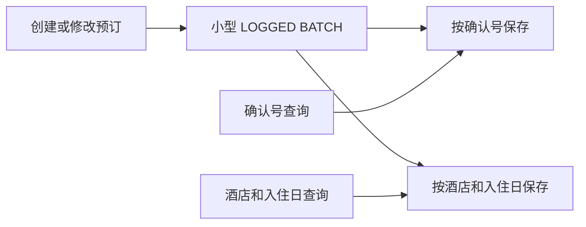

# 先列查询，再设计表

本项目要完成的主要读取只有两种：输入确认号获取一笔预订；输入酒店与入住日获取一组预订。Cassandra 不会把一个普通字段自动变成高效的查询入口，因此为这两种查询分别保存数据。

## 一笔预订的数据

| 字段 | C# | CQL | 含义 |
| --- | --- | --- | --- |
| confirmationNumber | Guid | text | 服务生成的确认号，保存为 UUID 字符串 |
| hotelId | string | text | 酒店代码，区分大小写，入参去除首尾空白 |
| startDate | DateOnly | date | 入住日 |
| endDate | DateOnly | date | 离店日，必须晚于入住日 |
| roomNumber | short | smallint | 房号，1 到 32767 |
| guestId | Guid | uuid | 客人标识，不在本服务维护客人档案 |

入住区间采用 `[startDate, endDate)` 的业务含义，离店日不算住宿的一天。本项目没有计算房间占用，也不会检查两笔预订的区间是否重叠。

确认号保留原项目的 CQL `text` 类型，API 使用 Guid 做格式验证。日期使用 `DateOnly`，避免把“入住日”误变成带时区的瞬时时间。

## 按确认号查询

```cql
CREATE TABLE reservations_by_confirmation (
    confirmation_number text PRIMARY KEY,
    hotel_id text,
    start_date date,
    end_date date,
    room_number smallint,
    guest_id uuid
);
```

`confirmation_number` 同时是完整主键和分区键。给定确认号即可定位一个分区里的这一行。

```cql
SELECT * FROM reservations_by_confirmation
WHERE confirmation_number = '把实际确认号粘贴到这里';
```

这里无法直接增加 `WHERE hotel_id = ...` 来代替第二张表。仅有分区键之外的字段值，并不能定位预订所在的分区。

## 按酒店和入住日查询

```cql
PRIMARY KEY ((hotel_id, start_date), room_number, confirmation_number)
```

最内层括号里的 `(hotel_id, start_date)` 是复合分区键，两项共同决定分区。后面的 `room_number` 和 `confirmation_number` 是聚簇列，决定分区内行的标识与排序。

例如 `H_BEIJING`、`2026-11-06` 是一个分区，可以包含：

| room_number | confirmation_number | end_date |
| --- | --- | --- |
| 101 | 确认号 A | 2026-11-09 |
| 101 | 确认号 B | 2026-11-08 |
| 202 | 确认号 C | 2026-11-10 |

完整主键不同，A 和 B 就是独立的两笔记录。原项目只使用房号作为聚簇键，同房同日的新写入会覆盖酒店日期表中的旧记录；加入确认号后，查询结果能够保留两笔。

```cql
SELECT * FROM reservations_by_hotel_date
WHERE hotel_id = 'H_BEIJING' AND start_date = '2026-11-06';
```

该查询只返回 11 月 6 日开始入住的预订。11 月 5 日已入住且尚未离店的订单不会出现在结果中。

## 为什么保存两份相同数据

关系数据库里通常先规范化，再通过索引或关联满足多种读取。这个示例在写入时多维护一份查询数据，换取读取时直接定位分区。



代价是应用必须维护冗余。改酒店、入住日或房号时，旧表行的主键也跟着变化，所以不能只在新主键上做 INSERT。Repository 会先读取旧记录，再把删除旧查询行与写入新记录放入同一个小型 LOGGED BATCH。

如果只修改离店日或客人，酒店日期表的主键没有改变，直接更新两表即可。此时不执行“删除再插入同一个主键”，避免引入不必要的 tombstone。

## 分区大小与全表列表

一天一个酒店一个分区，适合教学与一般小数据演示，但不是任意规模都适用。如果酒店每天的记录非常多，或历史数据无限保存，需要根据行大小、吞吐量和访问模式评估分区大小，再考虑更细的时间桶或其他拆分方式。

`GET /api/v1/reservations` 是保留原项目功能的教学性全表浏览。游标控制单次读取数量，不能把跨分区扫描变成生产环境的低成本检索。它没有全局日期排序，也不执行昂贵的 `COUNT(*)`。

本项目不使用 `ALLOW FILTERING`，也没有创建辅助索引来掩盖查询与主键不匹配的问题。

## 亲手观察

先启动 API 并运行 seed 脚本，再进入数据库：

```powershell
docker compose exec cassandra cqlsh
```

```cql
USE reservation_service;
DESCRIBE TABLE reservations_by_confirmation;
DESCRIBE TABLE reservations_by_hotel_date;
SELECT * FROM reservations_by_hotel_date
WHERE hotel_id = 'H_BEIJING' AND start_date = '2026-11-06';
```

通过 API 修改其中一笔的酒店和日期，然后重新查询旧分区与新分区。观察确认号保持不变，而酒店日期表中数据的位置发生变化。

参考：[原项目数据模型](https://github.com/jeffreyscarpenter/reservation-service/blob/20a6384a39eaa87e1c4e143509ac67011875e218/src/main/resources/reservation.cql)、[Apache Cassandra 数据建模文档](https://cassandra.apache.org/doc/latest/cassandra/developing/data-modeling/intro.html)。
